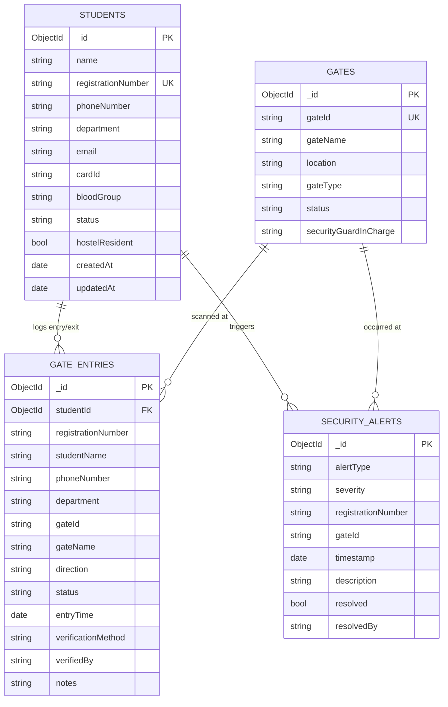

# 🏛️ University Gate Entry System - MongoDB & mongosh Setup (CA Submission)

> **Continuous Assessment (CA) Project**  
> **Topic:** MongoDB Schema Design, `$jsonSchema` Validation, Index Optimization, and Analytical Queries using `mongosh`  
> **Target Database:** `university_gate_db`  
> **Tools:** `mongosh` (MongoDB Shell 2.0+), Docker, Docker Compose, MongoDB 7.0  

---

## 📌 1. Project Overview & Architecture

The **University Gate Entry System** records real-time gate movements (entries and exits) across multiple campus gates using QR codes and student RFID badges. 

While the initial prototype utilized an in-memory SQL store (H2), this module introduces a **production-ready NoSQL architecture powered by MongoDB**. MongoDB is well-suited for university security & gate recording because of:
1. **High Write Throughput**: Fast appending of thousands of simultaneous gate scan events during peak morning rush.
2. **Flexible Document Model**: Allows storing heterogeneous security metadata (e.g., RFID badge scan vs mobile QR confirmation vs biometric verification) without schema alteration.
3. **Time-Series & Event Logging**: Fast querying for live dashboards, historical audits, and automated TTL (Time-To-Live) data retention.
4. **Data Integrity via `$jsonSchema`**: Strong schema validation enforced at the database level to ensure no malformed student records or gate events are stored.

---

## 📊 2. Entity-Relationship & Document Schema



---

## 📂 3. Directory Structure

```
university-entry-system/
├── mongo-init/
│   ├── 01-init-db.js       # Database creation, App User, $jsonSchema Validators & Indexes
│   ├── 02-seed-data.js     # Realistic campus seed data (students, gates, entries, alerts)
│   ├── 03-ca-queries.js    # 10 comprehensive CA evaluation queries & aggregations
│   └── init.js             # Master runner executing 01 and 02 with verification stats
├── scripts/
│   ├── run-mongosh.sh      # Bash script to run mongosh (interactive, init, or queries)
│   └── export-data.sh      # Helper to export collections to formatted JSON
├── docker-compose.yml      # Multi-container setup (Spring Boot + MongoDB 7 + Mongo Express)
├── MONGODB_INIT.md         # Comprehensive CA project documentation (this file)
└── README.md               # Main project README
```

---

## 🚀 4. How to Run the Project

### Option A: Using Docker Compose (Recommended - Fully Automated)

The fastest and most reproducible way to run the entire system:

1. **Start MongoDB, Mongo Express, and Application:**
   ```bash
   docker compose up -d
   ```

2. **What happens automatically:**
   - Docker pulls and spins up `mongo:7.0`.
   - The directory `./mongo-init` is mounted into `/docker-entrypoint-initdb.d/`.
   - Docker automatically runs `01-init-db.js` and `02-seed-data.js` via `mongosh` on first boot.
   - Database `university_gate_db` is created with all validators, indexes, and sample data.

3. **Verify the services:**
   - **Mongo Express Web UI**: Open [http://localhost:8081](http://localhost:8081) in your browser to view and explore all collections graphically.
   - **Gate Entry App**: Open [http://localhost:9090](http://localhost:9090).

---

### Option B: Using Local `mongosh` CLI

If you have a local MongoDB instance running on your machine:

1. **Run Master Initialization:**
   ```bash
   mongosh "mongodb://localhost:27017/university_gate_db" mongo-init/init.js
   ```

2. **Execute CA Demonstration Queries:**
   ```bash
   mongosh "mongodb://localhost:27017/university_gate_db" mongo-init/03-ca-queries.js
   ```

3. **Launch Interactive Shell with helper script:**
   ```bash
   ./scripts/run-mongosh.sh
   # Or directly:
   mongosh "mongodb://localhost:27017/university_gate_db"
   ```

---

### Option C: Using MongoDB Atlas (Cloud)

1. Obtain your Atlas connection string:
   `mongodb+srv://<username>:<password>@cluster0.mongodb.net/university_gate_db`
2. Run the initialization script against your cloud cluster:
   ```bash
   mongosh "mongodb+srv://<username>:<password>@cluster0.mongodb.net/university_gate_db" mongo-init/init.js
   ```

---

## ⚡ 5. Indexing Strategy & Performance Rationale

| Collection | Index Fields | Type | Purpose / Rationale |
| :--- | :--- | :--- | :--- |
| `students` | `{ registrationNumber: 1 }` | **Unique** | Enforces campus-wide student uniqueness; enables $O(1)$ fast lookups when scanning cards/QRs. |
| `students` | `{ name: "text", department: "text" }` | **Text Index** | Supports full-text search across student names and departments for administrative search. |
| `students` | `{ department: 1, status: 1 }` | **Compound** | Accelerates departmental queries (e.g., list all ACTIVE CSE students). |
| `gates` | `{ gateId: 1 }` | **Unique** | Guarantees uniqueness for physical gate checkpoints (e.g., GATE-01). |
| `gate_entries` | `{ entryTime: -1 }` | **Descending** | Optimizes live dashboard queries showing the latest 10-50 gate events in reverse chronological order. |
| `gate_entries` | `{ registrationNumber: 1, entryTime: -1 }` | **Compound** | Drastically speeds up student movement history queries ("Show all scans for student X in the last week"). |
| `gate_entries` | `{ gateId: 1, entryTime: -1 }` | **Compound** | Powers gate-specific traffic monitoring. |
| `security_alerts` | `{ timestamp: 1 }` (TTL) | **TTL Index** | Automatically expires and removes security audit logs older than 90 days (`expireAfterSeconds: 7776000`). |

---

## 🔍 6. CA Demonstration Queries Walkthrough

The script `mongo-init/03-ca-queries.js` includes 10 key operations tailored for the CA presentation:

### Query 1: Filter & Projection with Multi-Field Sort
```javascript
db.students.find(
  { status: "ACTIVE" },
  { _id: 0, registrationNumber: 1, name: 1, department: 1, phoneNumber: 1 }
).sort({ department: 1, name: 1 });
```
*Purpose:* Generates an active student roster grouped logically by academic department.

---

### Query 2: Indexed Profile Lookup
```javascript
db.students.findOne({ registrationNumber: "12104501" });
```
*Purpose:* Demonstrates instant index seek using the unique `registrationNumber` index.

---

### Query 3: Real-Time Live Security Dashboard Feed
```javascript
db.gate_entries.find(
  {},
  { _id: 0, registrationNumber: 1, studentName: 1, gateName: 1, direction: 1, status: 1, entryTime: 1 }
).sort({ entryTime: -1 }).limit(5);
```
*Purpose:* Replicates the laptop live-feed showing recent gate entries.

---

### Query 4: Aggregation Pipeline — Traffic Volume by Campus Gate
```javascript
db.gate_entries.aggregate([
  {
    $group: {
      _id: { gateId: "$gateId", gateName: "$gateName" },
      totalTraffic: { $sum: 1 },
      grantedEntries: { $sum: { $cond: [{ $eq: ["$status", "GRANTED"] }, 1, 0] } },
      deniedAttempts: { $sum: { $cond: [{ $eq: ["$status", "DENIED"] }, 1, 0] } }
    }
  },
  {
    $project: {
      _id: 0,
      gateId: "$_id.gateId",
      gateName: "$_id.gateName",
      totalTraffic: 1,
      grantedEntries: 1,
      deniedAttempts: 1
    }
  },
  { $sort: { totalTraffic: -1 } }
]);
```
*Purpose:* Calculates total movements, approved entries, and blocked entries per physical gate.

---

### Query 5: Aggregation Pipeline — Hourly Peak Traffic Detection
```javascript
db.gate_entries.aggregate([
  {
    $project: {
      hourOfDay: { $hour: "$entryTime" },
      direction: 1
    }
  },
  {
    $group: {
      _id: "$hourOfDay",
      totalEvents: { $sum: 1 }
    }
  },
  { $sort: { totalEvents: -1 } }
]);
```
*Purpose:* Extracts the hour from timestamp (`$hour`) to determine campus peak arrival/departure hours.

---

### Query 6: Multi-Collection Join with `$lookup`
```javascript
db.gate_entries.aggregate([
  {
    $lookup: {
      from: "students",
      localField: "registrationNumber",
      foreignField: "registrationNumber",
      as: "studentInfo"
    }
  },
  { $unwind: "$studentInfo" },
  {
    $group: {
      _id: "$studentInfo.department",
      totalGatePasses: { $sum: 1 },
      uniqueStudents: { $addToSet: "$registrationNumber" }
    }
  },
  {
    $project: {
      _id: 0,
      department: "$_id",
      totalGatePasses: 1,
      uniqueStudentCount: { $size: "$uniqueStudents" }
    }
  },
  { $sort: { totalGatePasses: -1 } }
]);
```
*Purpose:* Performs an SQL-like `LEFT OUTER JOIN` between `gate_entries` and `students` to calculate footfall per academic department.

---

### Query 7: Security Audit Report
```javascript
db.gate_entries.find(
  { status: { $in: ["DENIED", "FLAGGED"] } },
  { _id: 0, entryTime: 1, registrationNumber: 1, studentName: 1, gateName: 1, status: 1, notes: 1 }
).sort({ entryTime: -1 });
```
*Purpose:* Filters suspicious or denied access events for audit logs.

---

### Query 8: Full-Text Search
```javascript
db.students.find(
  { $text: { $search: "Computer" } },
  { score: { $meta: "textScore" }, name: 1, department: 1, registrationNumber: 1, _id: 0 }
).sort({ score: { $meta: "textScore" } });
```
*Purpose:* Uses text search weighting to find students based on keywords.

---

### Query 9: Atomic Document Update
```javascript
db.security_alerts.updateOne(
  { resolved: false, alertType: "SUSPENDED_STUDENT_ENTRY" },
  {
    $set: {
      resolved: true,
      resolvedBy: "CHIEF-SECURITY-OFFICER",
      resolutionNotes: "Disciplinary committee notified. Physical escort provided."
    },
    $currentDate: { resolvedAt: true }
  }
);
```
*Purpose:* Updates alert resolution status atomically and stamps the current date.

---

### Query 10: `$jsonSchema` Validation Rejection Test
```javascript
try {
  db.students.insertOne({
    name: "X",                             // Rejection: minLength is 2
    registrationNumber: "invalid_format!", // Rejection: regex violation
    phoneNumber: "123",                    // Rejection: pattern violation
    department: "NonExistentDept",         // Rejection: enum violation
    status: "UNKNOWN"                      // Rejection: enum violation
  });
} catch (err) {
  print("Document rejected by $jsonSchema validation: " + err.message);
}
```
*Purpose:* Proves database-level schema constraints work by attempting an invalid insert and catching `DocumentValidationFailure`.

---

## 🎓 7. CA Viva / Oral Exam Preparation Q&A

### Q1: Why use MongoDB instead of SQL (MySQL/PostgreSQL) for a Gate Entry System?
> **Answer:** Gate entry systems produce high-velocity stream-like write events during rush hours (8:30 AM - 9:30 AM). MongoDB offers superior insert performance with horizontal scalability (sharding). Furthermore, different gate entry types (RFID tap, QR scan, biometric, manual visitor pass) contain varying metadata, which fits MongoDB's flexible BSON document model without requiring complex multi-table joins or schema migrations.

### Q2: What is the purpose of `$jsonSchema` in MongoDB?
> **Answer:** By default, MongoDB has a dynamic schema. `$jsonSchema` allows developers to define validation rules directly in the database engine (specifying required fields, data types, string length, regex patterns, and allowed enum values). This prevents corrupted, incomplete, or malformed records from being inserted, combining the flexibility of NoSQL with the data safety of relational databases.

### Q3: Why is a compound index `{ registrationNumber: 1, entryTime: -1 }` used on `gate_entries`?
> **Answer:** Compound indexes follow the Equality, Sort, Range (ESR) rule. In a gate entry system, the most frequent user query is: *"Find all entries for Student X sorted from most recent to oldest."* By indexing `registrationNumber` (equality) first and `entryTime` (sort) descending second, MongoDB satisfies both the filter and sorting directly from index RAM (index seek without in-memory sort or full collection scan).

### Q4: How does the TTL (Time-To-Live) index work in MongoDB?
> **Answer:** A TTL index is created on a Date field with `expireAfterSeconds`. A background thread in `mongod` periodically reads this index and deletes documents whose timestamp exceeds the specified duration (e.g., 90 days). This handles compliance and automated log purging without needing external cron jobs.

### Q5: What is the difference between embedding and referencing in MongoDB, and what design did you choose?
> **Answer:** 
> - **Embedding** stores related data inside a single document (denormalization).
> - **Referencing** stores the `_id` of another document (similar to foreign keys).
> 
> *In our design:*
> We used a **hybrid approach**. `gate_entries` stores a reference (`studentId`) for integrity, but **denormalizes** essential snapshot fields (`studentName`, `phoneNumber`, `department`). Why? Because if a student changes their phone number or graduates 2 years later, the historical gate log from today should accurately reflect what their details were at the exact moment of entry without performing expensive joins.

---

## 📦 8. Useful Commands Cheat Sheet

| Task | Command |
| :--- | :--- |
| **Start with Docker** | `docker compose up -d` |
| **Stop Docker** | `docker compose down` |
| **Reset Database** | `docker compose down -v && docker compose up -d` |
| **Run All Init** | `./scripts/run-mongosh.sh --init` |
| **Run CA Queries** | `./scripts/run-mongosh.sh --queries` |
| **View Stats** | `./scripts/run-mongosh.sh --stats` |
| **Interactive mongosh** | `./scripts/run-mongosh.sh` |
| **Export to JSON** | `./scripts/export-data.sh ./exports` |
| **Open Mongo Express** | [http://localhost:8081](http://localhost:8081) |
